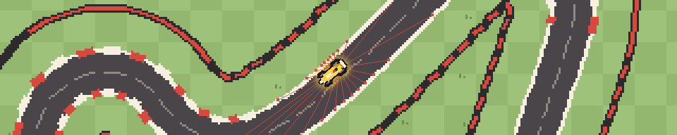

<p align="center">
  
  <br>
  <sub>Trained agent, training seed 0, on validation track 1019 at difficulty 1. The red lines are its lidar rays.</sub>
</p>

<h1 align="center">learn-for-speed</h1>

<p align="center">A 2D racing car that teaches itself to drive tracks it has never seen.</p>

<p align="center">
  
  
  
  
  
</p>

##  Introduction

learn-for-speed builds random closed circuits and trains a car to lap them as fast as it can. The car has no map. All it knows comes from its own sensors, a lidar with 25 rays plus its speed, its steering angle and how much it slides sideways. From that alone, a PPO agent learns when to brake, where to turn in and how hard it can push before the rear lets go.

##  Contents

- [Features](#-features)
- [Download and install](#-download-and-install)
- [Usage](#-usage)
- [Model results](#-model-results)
- [Driving keys](#-driving-keys)
- [Track seeds, training seeds and splits](#-track-seeds-training-seeds-and-splits)

##  Features

- Procedural closed tracks from a track seed and a difficulty between 0 and 1. Higher difficulty means more corners and tighter ones.
- Bicycle physics in Rust. The car grips in slow corners, drifts in fast ones and can reverse.
- Custom Gymnasium environment with sensor-only observations, no map of the track.
- PPO from Stable-Baselines3 on the CPU, with a curriculum that raises the difficulty as the agent improves.
- Reward for progress along the track, with penalties for wasted time, nervous steering, grass and crashes, and a bonus per lap.
- Random and pure pursuit baselines, evaluated on held-out tracks with confidence intervals.
- Keyboard driving on any track, and a local arcade dashboard where you race against the model.

##  Download and install

You need Linux, git, uv and Rust. The first `make setup` downloads the Python packages and compiles the physics core, which takes a few minutes.

```bash
curl -LsSf https://astral.sh/uv/install.sh | sh
curl https://sh.rustup.rs -sSf | sh -s -- -y --profile minimal -c clippy -c rustfmt
git clone https://github.com/DevPlague/learn-for-speed.git
cd learn-for-speed
make setup
make test
```

If you prefer not to install anything, Docker works as well. Run `make docker-build` once and `make docker-test` to check it, then use the same commands with the `docker-` prefix, such as `make docker-play`.

##  Usage

Everything runs through make from the repo folder. `make help` lists every command, and variables go after the command in capitals, as in `make play SEED=1002 DIFFICULTY=1`.

```bash
make play SEED=1002 DIFFICULTY=1                         # drive a track yourself
make train CONFIG=tiny SEED=0                            # one minute check that training works
make train-seeds CONFIG=final SEEDS="0 1 2"              # the final model, about 17 minutes on 8 cores
make eval POLICY=pure_pursuit                            # score a baseline on validation tracks
make eval POLICY=ppo MODEL=runs/final_s0/best_model.zip  # score your trained model
make dashboard                                           # replays and arcade race at a local link
```

Runs land in `runs/<config>_s<training seed>/`. The dashboard needs the three final runs and tells you how to train them if one is missing.

##  Model results

The final config was trained with three training seeds and tested once on 200 test tracks at each difficulty. Lap time is the mean over completed laps.

| Driver | Laps, difficulty 0 | Lap time | Laps, difficulty 1 | Lap time |
|---|---|---|---|---|
| PPO final | 100% | 24.2 s | 95.7% | 36.3 s |
| Pure pursuit | 100% | 29.5 s | 100% | 40.7 s |
| Random | 0% | none | 0% | none |

On tracks both finish, PPO is about 5 s faster per lap than pure pursuit. It is not flawless though. On the hardest tracks it misses about 4% of laps, usually by entering a corner too fast or by stopping on the grass and never recovering.

##  Driving keys

| Key | Action |
|---|---|
| Up | Accelerate, or brake while reversing |
| Down | Brake, then reverse once stopped |
| Left and Right | Steer |
| Esc | Quit |

An attempt ends after 10 s on the grass, on touching a barrier, after 10 s without progress or after 120 s, and you start again from the line. Take a corner too fast and the car will drift.

##  Track seeds, training seeds and splits

A track seed picks the circuit. The three ranges never overlap, and the evaluation script refuses training track seeds, so no training track can leak into the results.

| Split | Track seeds | Used for |
|---|---|---|
| Train | 100000 and up | Training, a new random one each episode |
| Validation | 1000 to 1999 | Development and model selection, the default of `make eval` |
| Test | 10000 to 99999 | Final results only, with `SPLIT=test`, never for tuning |

A training seed is something else. It is the 0, 1 or 2 in run names like `final_s0`, and it fixes the starting weights of the network and the randomness of PPO. One run uses one training seed and thousands of track seeds, and the three runs of a config are three independent trainings of the same method.
