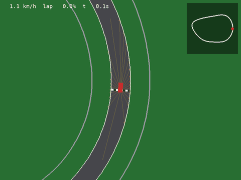

<p align="center">
  
</p>

<p align="center">
  
  
  
  
  <br>
  
  
</p>

<h1 align="center">learn-for-speed</h1>

<p align="center">A 2D top-down racing car that <b>learns to drive circuits it has never seen</b>, using reinforcement learning.</p>

## 🏁 Introduction

learn-for-speed generates random closed circuits and trains a PPO agent to lap them as fast as it can.

- The car sees the world only through its own sensors. A simulated lidar with 25 rays, plus its speed, steering and sideways slip. No map, no centerline, no GPS.
- Physics are a bicycle model written in Rust. The car grips in slow corners, drifts in fast ones and can reverse out of trouble.
- Every result is measured on **held-out tracks** the agent never trained on, against a random driver and a hand-written pure pursuit controller.

The GIF above is the pure pursuit baseline on validation track 1000. The yellow lines are the lidar rays the agent gets as input.

## Contents

- [Features](#-features)
- [Install](#-install)
- [Commands](#-commands)
- [Tracks and difficulty](#-tracks-and-difficulty)
- [Configs](#%EF%B8%8F-configs)
- [Driving keys](#driving-keys)
- [Seeds and splits](#seeds-and-splits)

## ✨ Features

**Simulation**

- Procedural closed spline tracks with a difficulty knob from 0 (gentle) to 1 (tight corners).
- Rust physics core, one call per step with NumPy arrays, so training stays fast and headless.
- Grass is allowed but slow and slippery. Barriers end the attempt.
- Drive any track yourself with the keyboard.

**Learning**

- Custom Gymnasium env with a 28 value observation in [-1, 1] and a 2 value action, steer and throttle or brake.
- Reward for progress along the centerline, with penalties for time, steering jitter, grass, standing still, crashing and getting stuck, and a bonus for each lap.
- PPO from Stable-Baselines3 on CPU, parallel envs, one YAML config per experiment, checkpoints and a validation curve during training.

**Evaluation**

- Random and pure pursuit baselines.
- Lap success, off-track and stuck rates, lap time, speed and progress, as a Markdown table and JSON, with mean ± std over training seeds.

**Dashboard**

- One static page built from `runs/`. Learning curves, validation tables, synced replays of every policy with lidar and follow camera, and physics plots. No server needed.

## 📦 Install

Pick one. Local is faster and needs Rust. Docker needs nothing but Docker.

**Option A, local on Linux**

```bash
curl -LsSf https://astral.sh/uv/install.sh | sh                                            # uv, the Python tool
curl https://sh.rustup.rs -sSf | sh -s -- -y --profile minimal -c clippy -c rustfmt     # Rust, for the physics core
git clone git@github.com:DevPlague/learn-for-speed.git
cd learn-for-speed
make setup     # first run downloads dependencies and compiles Rust, a few minutes
make test      # everything should pass
```

**Option B, Docker**

Install Docker from [the official guide](https://docs.docker.com/engine/install/). Your user must be able to run `docker` without `sudo`.

```bash
git clone git@github.com:DevPlague/learn-for-speed.git
cd learn-for-speed
make docker-build   # again whenever rust/, pyproject.toml or uv.lock change
make docker-test
```

Your folder is mounted into the container, so Python changes apply at once and everything written to `runs/` lands on your disk.

## 🚦 Commands

Every command runs from the repo folder. `make help` lists them all, and variables go after the command, like `make play SEED=1002`.

| Task | Command |
|---|---|
| Create the env and build the Rust core | `make setup` |
| Force a Rust rebuild, normally automatic | `make rust` |
| Run all tests, lint, auto-format | `make test`, `make lint`, `make format` |
| Env speed and track generation time | `make bench` |
| Drive a track by keyboard | `make play SEED=1002 DIFFICULTY=1` |
| Train one seed of a config into `runs/<config>_s<seed>/` | `make train CONFIG=mvp SEED=0` |
| Watch training curves on http://localhost:6006 | `make tb` |
| Evaluate a baseline on validation tracks | `make eval POLICY=pure_pursuit N=50 DIFFICULTY=1` |
| Evaluate PPO, one zip per training seed | `make eval POLICY=ppo MODEL="runs/mvp_s0/best_model.zip runs/mvp_s1/best_model.zip"` |
| Final test table, once, never to tune | `make eval POLICY=ppo MODEL="..." SPLIT=test N=200` |
| Intervals and paired tests between evals | `make run CMD="python -m evaluation.stats ppo=runs/eval_ppo_val/eval.json pp=runs/eval_pure_pursuit_val/eval.json"` |
| Learning curve over seeds | `make run CMD="python -m evaluation.plots curve --runs runs/mvp_s0 runs/mvp_s1 runs/mvp_s2 --label mvp"` |
| Bar chart and failure plots | `evaluation.plots bars --evals name=eval.json ...` and `evaluation.plots failures --policy ppo --model runs/mvp_s1/model.zip` |
| Side by side video into `videos/` | `make run CMD="python -m evaluation.demo --policies ppo pure_pursuit --model runs/mvp_s0/best_model.zip --seed 1000"` |
| Dashboard into `runs/dashboard/index.html` | `make dashboard RUNS="mvp_s0 mvp_s1"` |
| Any command inside the env | `make run CMD="python x.py"` |

`make eval` defaults to the first 20 validation tracks at difficulty 0.5 and writes `runs/eval_<policy>_<split>/eval.json`. Pass `--out` through `make run CMD="python -m evaluation.evaluate ..."` to keep several difficulties apart.

Docker runs the same steps without installing anything. `make docker-build` once and after any change in `rust/` or the dependencies, `make docker-test`, `make docker-play`, `make docker-tb`, `make docker-shell` and `make docker-run CMD="python -m learning.train --config configs/mvp.yaml --seed 0"` for any other command.

## 🛣 Tracks and difficulty

`generate_track(seed, difficulty)` in `sim/track.py` builds every track, and the same seed and difficulty always give the same one. It puts control points around a 70 m circle with some noise in angle and radius, draws a closed cubic spline through them and resamples it at one point per meter. Corners tighter than 12 m are widened in place so the inner barrier never folds, and loops whose far parts come too close are redrawn. The road is 8 m wide with 8 m of grass to the barrier on each side.

Difficulty is any number from 0 to 1. It sets the control points (6 to 12) and the noise (0.1 to 0.5), so higher means more and tighter corners.

| Difficulty | Control points | Points tighter than 25 m | Pure pursuit lap |
|---|---|---|---|
| 0 | 6 | 2% | 29.5 s |
| 0.5 | 9 | 10% | 32.3 s |
| 1 | 12 | 26% | 41.5 s |

Pick it with `DIFFICULTY=` in `make play` and `make eval`, or with `difficulty` in a config. Formulas are in [docs/PHYSICS.md](docs/PHYSICS.md).

## ⚙️ Configs

One YAML in `configs/` per experiment, and its file name is the run name. To try something, copy a config, change one thing and train it with 3 seeds.

| Key | Meaning |
|---|---|
| `total_timesteps`, `n_envs` | Training length and parallel envs |
| `difficulty` | Track difficulty the agent trains on |
| `checkpoint_freq` | Steps between `checkpoints/*.zip` |
| `eval.freq`, `eval.tracks` | Validation every so many steps, on the first tracks from seed 1000. Fills `val_curve.csv` and picks `best_model.zip` |
| `reward.*` | Weights of `RaceReward` in `learning/reward.py`, progress, time, jitter, grass, idle, crawl, off_road, stuck and lap |
| `ppo.*` | Passed straight to Stable-Baselines3 PPO |

| Config | What it is | Time on 8 cores |
|---|---|---|
| `tiny` | 20k steps, checks that everything runs | under a minute |
| `probe`, `probe_nojitter` | 200k step reward checks from week 2 | a few minutes |
| `probe_mvp`, `probe_ent`, `probe_crawl` | 300k step checks of `mvp`, with an entropy bonus and with crawl instead of idle | about 5 minutes |
| `mvp` | the main run, 2M steps | about 30 minutes, ask the team first |

## Driving keys

| Key | Action |
|---|---|
| Up | Accelerate, or brake while reversing |
| Down | Brake, and once stopped, reverse |
| Left, Right | Steer |
| Esc | Quit |

An attempt fails after 10 s in a row on grass, on reaching the barrier, after 10 s without progress, or after 120 s. A failed attempt or a finished lap puts you back on the start line. Corners taken too fast make the car drift, as [the physics guide](docs/PHYSICS.md) explains.

## Seeds and splits

| Split | Track seeds | Used for |
|---|---|---|
| Train | 100000 and up | Training only, random every episode |
| Validation | 1000 to 1999 | Everything while developing, `make eval` default |
| Test | 10000 and up | Final results only, with `SPLIT=test`. Never tune on it |

The evaluation script rejects training seeds, so no training track reaches the results.
